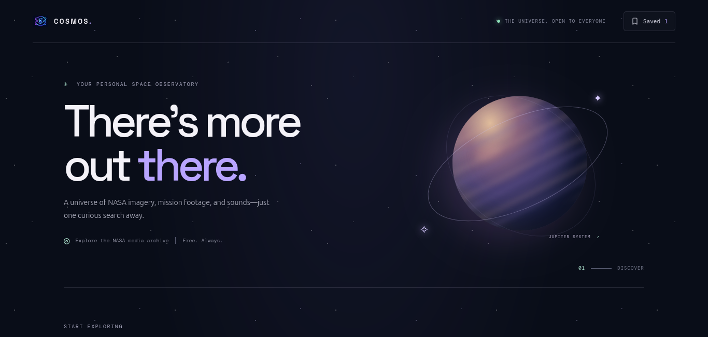
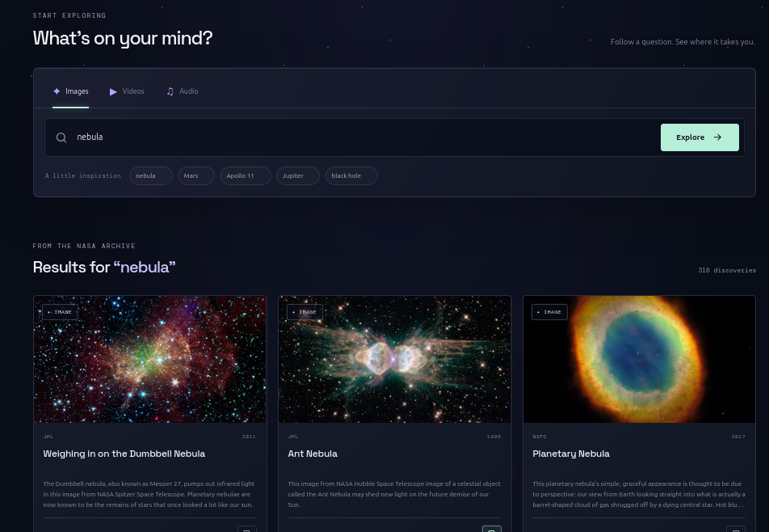

# COSMOS — NASA Space Archive Explorer



COSMOS is a responsive React web app for exploring NASA's public media archive. Search for space imagery, videos, and audio; open asset details; and save discoveries locally for later.

## Features



- Search NASA's public Images API by keyword.
- Filter results by images, videos, or audio.
- Explore suggested topics to get started quickly.
- Open a detail view with metadata and available media.
- Save and remove favourites using browser `localStorage`.
- Responsive layout with keyboard-friendly controls and reduced-motion support.

## Tech stack

- React
- Vite
- Plain CSS
- NASA Images API — no API key required for the search endpoint used here

## Getting started

### Requirements

- Node.js 20.19+ or 22.12+
- pnpm (recommended; the repository includes `pnpm-lock.yaml`)

### Install and run

```bash
git clone https://github.com/code-devkmd/cosmos
cd cosmos-github
pnpm install
pnpm dev
```

Vite prints a local URL (usually `http://localhost:5173`).

### Production build

```bash
pnpm lint
pnpm build
pnpm preview
```

The production-ready static site is generated in `dist/`. `dist/` is build output and should not be committed; the GitHub repository contains the source code needed to recreate it.

## Project structure

```text
.
├── public/                 # Static files served as-is
├── src/
│   ├── components/
│   │   └── Icon.jsx        # Shared SVG icon component
│   ├── data/
│   │   └── constants.js    # API endpoint, media types, discovery topics
│   ├── lib/
│   │   ├── nasa.js         # NASA result metadata helpers
│   │   └── storage.js      # Saved discoveries in localStorage
│   ├── styles/
│   │   └── App.css         # App-specific styling
│   ├── App.jsx             # Main app composition and state
│   ├── index.css           # Global styles and reset
│   └── main.jsx            # React entry point
├── .gitignore
├── index.html
├── package.json
├── pnpm-lock.yaml
└── vite.config.js
```

## Data and privacy

Search requests go directly from the browser to NASA's public API. Saved discoveries are stored only in the current browser's local storage; they are not synced between devices or accounts.

## Notes

- NASA API responses and original media availability can vary. Some video/audio records may not expose a directly playable file.
- This is an independent project and is not affiliated with or endorsed by NASA.
- Please review NASA's media usage guidance before reusing assets outside this project.

## Contributing

Issues and pull requests are welcome. Keep changes focused, maintain accessible labels and keyboard focus states, and run `pnpm lint` and `pnpm build` before submitting a pull request.

## License

Released under the MIT License. See [LICENSE](./LICENSE).
